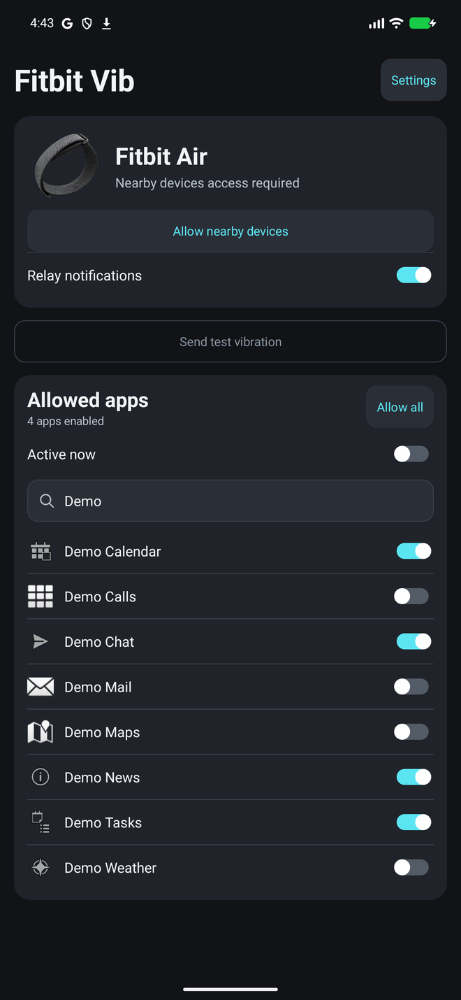
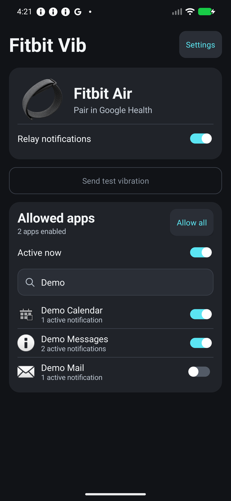
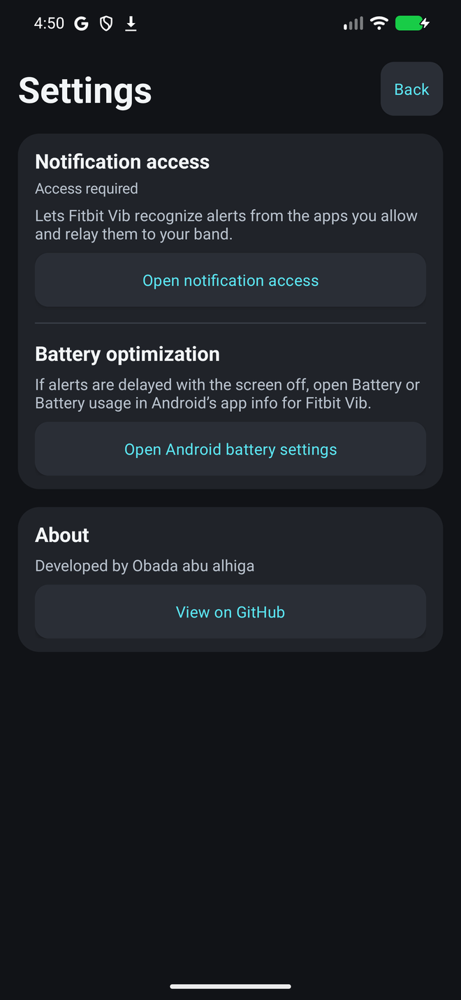

<div align="center">
  
  <h1>FitBit AirV</h1>
  <p>Selected Android notifications, felt on your Fitbit Air.</p>
  <p><a href="https://github.com/error0327/fitbit-vib/releases/latest"><strong>Download the latest APK</strong></a></p>
</div>

FitBit AirV is an independent Android companion for the screenless Fitbit Air. Choose which apps can make your band buzz while Google Health continues to handle pairing, health sync, alarms, and tracker settings.

<table align="center">
  <tr>
    <th>Choose apps</th>
    <th>Review active notifications</th>
    <th>Set up background alerts</th>
  </tr>
  <tr>
    <td></td>
    <td></td>
    <td></td>
  </tr>
</table>

Screenshots use an Android emulator with sample notifications.

## Get started

You need Android **12L (API 32) or later**, Bluetooth, and **one Fitbit Air** already paired to that phone in Google Health.

1. Download the signed APK from [GitHub Releases](https://github.com/error0327/fitbit-vib/releases/latest) and open it on Android.
2. Open FitBit AirV and allow **Nearby devices**.
3. In the setup popup or **Settings**, enable **Notification access**. If Android restricts listener access for a sideloaded app, open FitBit AirV's Android **App info** and check the overflow menu for **Allow restricted settings**.
4. If background alerts are delayed, tap **Open Android battery settings** in the setup popup or in **Settings**. This opens Android’s **App info** page for FitBit AirV. Open **Battery** or **Battery usage** to manage background activity.
5. Tap **Send test vibration**, then switch on the apps you want under **Allowed apps**. Use **Active now** to review apps with current notifications and change their switches.

The allowlist starts empty. **Relay notifications** pauses automatic alerts while keeping your app choices. **Allow all** enables every app in the regular list, including apps outside the active search.

## How it works

- FitBit AirV checks the source app and basic Android notification flags. Notification text stays unread. The APK has no internet permission, and your allowlist stays on your phone.
- The app sends a short pulse over the tracker’s Bluetooth connection using the intensity set on the Fitbit Air. It reads back the intensity after the write.
- The tracker shares its connection with Google Health. FitBit AirV waits for a quiet period and can skip an alert if the tracker is busy or unavailable. Notification bursts can be combined, and stale requests expire.

Keep vibration enabled on the tracker. If a test fails while Google Health is syncing, retry once the sync finishes. The first public release was built and tested on an emulator. Phone and tracker combinations beyond the development setup are still unverified.

## Build

Use JDK 17 and Android SDK 36. On Windows:

```powershell
.\gradlew.bat :app:assembleDebug :app:lintDebug
```

On macOS or Linux:

```sh
./gradlew :app:assembleDebug :app:lintDebug
```

The debug APK is at `app/build/outputs/apk/debug/app-debug.apk`. If you already have a development build, record your app choices before uninstalling it and installing the separately signed public APK.

## Credits

- Android Bluetooth transport and native libraries from [fitbit-air at 05273a3](https://github.com/ThoreKoritzius/fitbit-air/tree/05273a39f5c480a5dc45700f39f80e00cc48c2c5). Android channel shims adapted from [Air Signals at 2ddaa52](https://github.com/yashsharan0805/air-signals/tree/2ddaa5210362cca3e092b6c51e94eba4fa65ef07).
- The Obsidian tracker image comes from the [Google Store](https://store.google.com/us/config/google_fitbit_air?hl=en-US).
- Third-party licenses and notices are [included in the source and APK](app/src/main/assets/licenses).

FitBit AirV is an independent project. Fitbit and Google Health are names of Google products.
